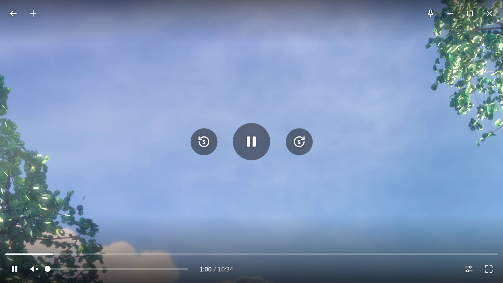

# Pane

A Windows desktop player for YouTube and Twitch where every window is nothing but the video.

Each window is frameless and locked to the video's shape, so there are no black bars and no page around it. Controls appear only while the mouse is over the window. Open as many windows as you like; each plays its own sound.



## What it does

- Plays YouTube videos and live streams, and Twitch channels, past broadcasts and clips, using each site's own player behind a single custom interface.
- Shows nothing about the video unless you hover: no title, no viewer count, no permanent chrome.
- Hover controls: back, new window, pin on top, play/pause and step buttons in the middle, seek bar, volume, captions, live chat panel, quality and speed, full screen.
- Picks the highest available quality by default.
- Drag the video to move the window (Windows Snap works); resize from any edge and the window keeps the video's shape.
- Watch history per site, with resume for recordings.
- Paste or drop a link, or let Pane offer links you copy. Global hotkeys work when Pane isn't focused. Press `?` in a window for the full shortcut list.
- Blocks the sites' ads by default (right-click, **Block ads**, to turn it off).
- Optional browser extension that adds **Open in Pane** to the right-click menu on video thumbnails.

## Requirements

- Windows 10 or 11 (64-bit).
- A recent Node.js to build it (developed with Node 24).

## Run from source

```bash
npm install
```

```bash
npm start
```

To open a link straight away: `npm start -- https://www.youtube.com/watch?v=aqz-KE-bpKQ`

## Build and install

```bash
npm run release
```

This packages the app into `dist/Pane-win32-x64/` and installs it for the current user in `%LOCALAPPDATA%\Programs\Pane`, with a Start menu shortcut. `npm run package` only builds.

Your settings, history and sign-ins live in `%APPDATA%\Pane` and are never touched by an update.

## Signing in

Signing in is optional; it is what makes a paid, ad-free account apply inside Pane.

- **Twitch:** right-click, **Accounts**, sign in on Twitch's own page.
- **YouTube:** Google does not allow its sign-in page inside apps, and Pane does not try to get around that. Instead you bring an existing browser session over from the Accounts panel, which explains the steps. Do it from a private browser window, so the session you bring over is not the one your everyday browser keeps using.

Sign-in data stays on your PC, in Pane's own data folder.

## Browser extension (optional)

`extension/` is a small extension for Brave or Chrome. On youtube.com and twitch.tv, right-clicking a video's thumbnail or title shows a short menu with **Open in Pane** first; Shift + right-click gives the browser's normal menu.

1. Install Pane (`npm run release`) and start it once, so Windows learns the `pane://` link type.
2. Open `brave://extensions` (or `chrome://extensions`) and turn on **Developer mode**.
3. Click **Load unpacked** and choose `%LOCALAPPDATA%\Programs\Pane\extension` (or the `extension` folder of this repository).

## How it is put together

Pane is an Electron app. Each window stacks the site's real page (restyled so only the video shows), Pane's own transparent interface on top, and optionally the site's chat. Everything specific to a site lives in a provider folder under `src/main/providers/`.

[CLAUDE.md](CLAUDE.md) is the full developer guide: architecture, where to add things, the rules the interface follows, known pitfalls, and how to test. It doubles as the instruction file for AI coding assistants.

There is no unit test suite. The scripts in `probe/` drive the real app off-screen and silently, and are the regression check; CLAUDE.md lists what each one covers.

## Good to know

- Pane is an independent project. It is not affiliated with or endorsed by YouTube, Google, Twitch or Amazon, and it depends on how their sites work today, which changes without notice. The ad blocking in particular needs upkeep.
- Whether using a third-party player or blocking ads fits a site's terms of service is for you to judge.
- Windows only for now: moving, resizing and window styling use Windows APIs directly.

## Licence and credits

Pane is released under the [MIT licence](LICENSE).

- Twitch ad handling uses the `vaft` script from [TwitchAdSolutions](https://github.com/pixeltris/TwitchAdSolutions), bundled unchanged under its MIT licence (`src/main/providers/twitch/vendor/`).
- The screenshot shows a frame of *Big Buck Bunny*, © Blender Foundation, [CC BY 3.0](https://creativecommons.org/licenses/by/3.0/).
